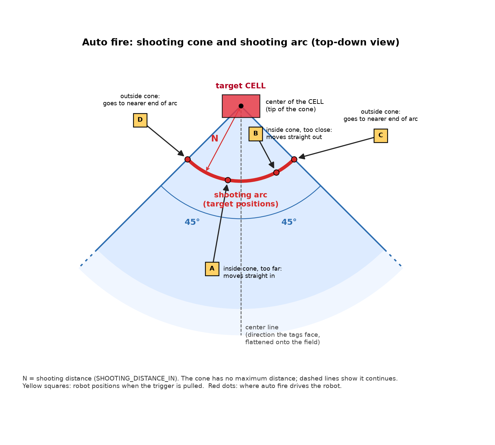
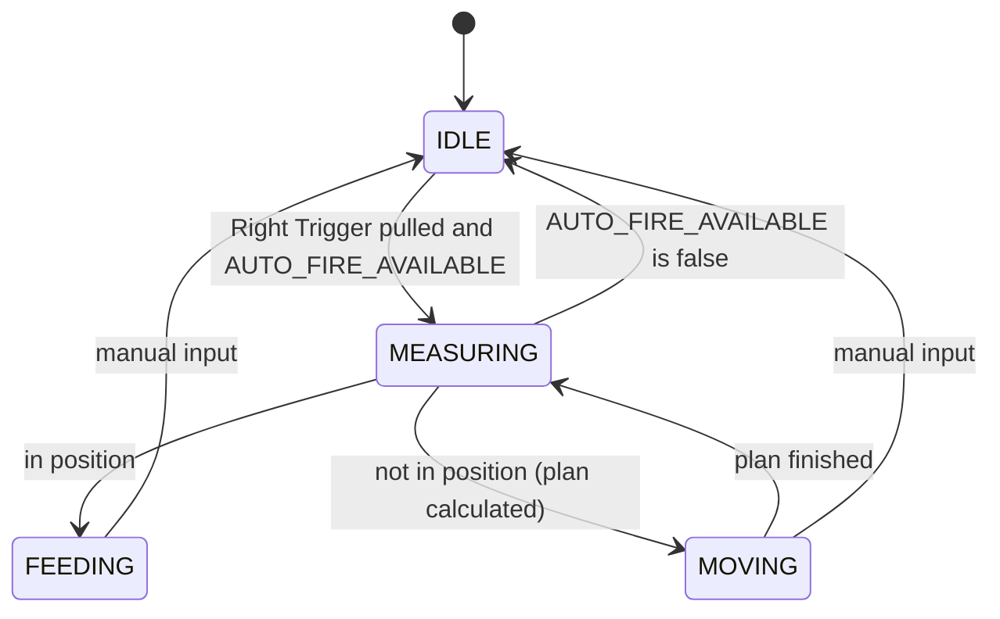

# FTC 2026 Biobuzz Challenge: TeleOp Technical Requirements
**Reference:** [FIRST Tech Challenge Game and Season](https://www.firstinspires.org/programs/ftc/game-and-season)

## Scope
This document covers the **TeleOp** period only: the 2-minute driver-controlled part of the match. The autonomous period (AUTO) is out of scope and will need its own document. Anything here about initialization, alliance selection, or the shooter applies to the TeleOp OpMode.

## How to Read This Document
Each section is split into two parts:

* **Requirement:** what the robot must do, as seen by the drivers. These change rarely, and every requirement should be testable on the field.
* **Design:** how we have decided to meet the requirement right now. These can change as we test, as long as the requirement is still met.

Facts we don't control, such as the field layout, the AprilTag IDs, and how our robot is built, are in the **Reference** section at the end. Every tunable value is listed in the **Tunable Values** table at the end.

---

## Hardware and Initialization

### Requirement
* During initialization, the robot must look for every device listed in Reference: Robot Hardware.
* If any single device cannot be found, it must not cause an error. The robot reports it as a warning on the Driver Hub and completes initialization.
* With a device missing, the robot keeps as much working as it can:
  * **No webcam:** auto fire and the auto-fire availability notification are disabled. Everything else works normally.
  * **No IMU:** auto fire is disabled, because its movement plans use the IMU to turn. Driving falls back to robot-centric (the sticks move the robot relative to the way it is facing).
  * **No drive encoders:** auto fire is disabled (it cannot measure the in/out move). The Driver Hub shows a warning. Driving still works.

### Design
* The webcam is named `camera` in the robot configuration.
* The IMU is named `imu` in the robot configuration. The Driver Hub adds this entry automatically (on I2C port 0), and it must not be deleted or renamed.
* The code must be told how the Control Hub is mounted (see Reference: Robot Hardware) so that the IMU measures the robot's heading correctly.

> **Note:** The intake and shooter vibrate the mounted webcam enough to drop AprilTag detections. That is a hardware/mounting issue; see Reference: Robot Hardware. Auto fire and the availability notification ride through short dropouts with the X-of-Y detection gate.

### Logging
Robot logs (`RobotLog`) are **verbose for the whole TeleOp** while we are bringing this up: every interface logs init, missing hardware, state changes, and the values it used for a decision. The same facts that drive the LED also go to the Driver Hub. We can later turn the volume down with a verbosity setting.

---

## Alliance Selection

### Requirement
The driver chooses the alliance (Red or Blue) during initialization, after pressing INIT and before pressing Play.

* On **Gamepad 1**, press **X for Blue** or **B for Red**.
* The choice can be changed any number of times before Play. The last press wins.
* The Driver Hub shows the current choice, or **NOT SET** if no alliance has been chosen.
* There is no default alliance. If Play is pressed without choosing one:
  * Auto fire is disabled (the Right Trigger does nothing), and the Driver Hub keeps showing a warning that the alliance is not set.
  * Everything else (driving, intake, hopper, shooter) works normally.
  * The driver can still choose an alliance with the same buttons. Once chosen, auto fire works and the alliance is locked for the rest of the match.
* Once Play is pressed with an alliance chosen, the alliance cannot be changed for the rest of the match.

### Design
The SDK supports this directly: `opModeInInit()` keeps a loop running until Play is pressed, and gamepad methods such as `xWasPressed()` detect a single button press.

---

## Shooter

### Requirement
* The robot must be able to shoot at any time during TeleOp, with no wait for the shooter to spin up.
* Shot strength must stay consistent for the whole match, including as the battery drains.
* There are no driver controls for the shooter.

### Design
The shooter runs continuously for the entire match at one constant speed.

* The shooter starts spinning when the driver presses Play, not during initialization.
* Nothing in normal operation stops the shooter, including cancelling auto fire. It stops only when the match ends.
* The speed is a target speed in **RPM**, set by one tunable value, `SHOOTER_TARGET_RPM`, configured after testing.

The shooter is controlled by target speed, not by motor power. With a fixed power, the shooter slows down as the battery drains over the match, and shots fall short. With a target speed, the motor controller on the hub adjusts the power on its own to hold the RPM. This also brings the wheel back up to speed quickly after each shot.

This uses the FTC SDK's built-in velocity control on `DcMotorEx`:

```java
shooter.setMode(DcMotor.RunMode.RUN_USING_ENCODER);

double ticksPerRev = shooter.getMotorType().getTicksPerRev();
shooter.setVelocity(SHOOTER_TARGET_RPM / 60.0 * ticksPerRev); // ticks per second
```

* The shooter motor's **encoder cable must be connected** to the expansion hub. Without it, velocity control does not work.
* The shooter motor must be set to the correct motor type in the robot configuration on the Driver Station. `getTicksPerRev()` depends on it, so the wrong motor type gives the wrong speed.
* The RPM is measured at the motor's output shaft. If there is gearing or a belt between the motor and the shooter wheel, the wheel spins at a different speed.

> **Note:** Running the shooter all match still needs to be tested. The main risk is battery drain, which we don't expect to be a problem.

---

## Driving (Gamepad 1)

### Requirement
Driving is **field-centric**: the sticks move the robot relative to the driver's view of the field, not relative to the way the robot is facing.

* **Left stick:** move the robot, from the driver's point of view.
  * Up: away from the driver.
  * Down: toward the driver.
  * Left and right: to the driver's left and right.
* **Right stick (left/right):** turn the robot in place.
* **Back button** (called Share on PlayStation-style gamepads): reset forward. The driver points the robot straight away from themselves and presses it, and that direction becomes the new forward. This corrects drift during the match, or a wrong starting direction.

**Drive team procedure:** before pressing INIT, place the robot **facing straight away from the driver** (for example, with its back against our own alliance's wall).

### Design
The red and blue drivers stand on opposite sides of the field, facing each other (see Reference: Field), so "away from the driver" points in opposite directions for the two alliances.

The IMU only measures how far the robot has turned since it was last zeroed, so forward is set like this:
* The IMU heading is zeroed during initialization, while the robot is facing away from the driver. From then on, forward means away from the driver, for either alliance.
* Because forward is set from the robot's starting direction, driving does not depend on the alliance selection.
* The Back button zeroes the IMU heading again.

> **Note:** If an autonomous program runs before TeleOp, the robot will not be facing away from the driver when TeleOp starts, and it cannot be touched during the transition. In that case the driver uses the Back button to reset forward once TeleOp begins. Passing the robot's heading from autonomous to TeleOp is out of scope for now.

---

## Operator Controls (Gamepad 2)

### Requirement
* **Right Trigger:** start auto fire (see Auto Fire). This is the only way to shoot.
* **Left Trigger:** while held, run the intake inward at a predefined speed. Stops when released.
* **Left Bumper:** while held, run the intake outward at a predefined reverse speed. Stops when released.
* **X Button:** step the hopper 180 degrees in the feeding direction.
* **Y Button:** step the hopper 180 degrees in the opposite direction (-180 degrees).

The triggers are either held or not. How far a trigger is pulled does not change anything. A small deadzone decides when a trigger counts as held.

For both hopper buttons:
* Pressing the button starts one 180-degree step.
* When the step finishes, the robot checks whether the button is still held. If it is, the hopper does another 180-degree step, and so on until the button is released.
* A step always finishes once started, even if the button is released partway through. This keeps the hopper lined up at a 180-degree position.

### Design
Both intake speeds are target speeds in **RPM**, each set by its own tunable value:
* `INTAKE_TARGET_RPM`: the inward speed, used by the Left Trigger.
* `INTAKE_REVERSE_RPM`: the outward speed, used only by the Left Bumper.

They use the same SDK velocity control as the shooter:

```java
intake.setMode(DcMotor.RunMode.RUN_USING_ENCODER);

double ticksPerRev = intake.getMotorType().getTicksPerRev();
intake.setVelocity(INTAKE_TARGET_RPM / 60.0 * ticksPerRev);    // Left Trigger: inward, ticks per second
intake.setVelocity(-INTAKE_REVERSE_RPM / 60.0 * ticksPerRev);  // Left Bumper: outward, ticks per second
intake.setVelocity(0);                                         // released: stop
```

* As with the shooter, the intake motor's **encoder cable must be connected** to the expansion hub, and the motor must be set to the correct motor type in the robot configuration.
* If the intake encoder (or a usable motor type) is missing, the intake runs at **100% power** instead of RPM. The Driver Hub shows a warning.

---

## Auto Fire Availability Notification

### Requirement
* The operator must be notified when **auto fire is available**: an alliance has been chosen, the IMU is working, the target-cell detection gate is passing, and the robot is **inside the shooting cone**. Pulling the Right Trigger at that moment starts auto fire.
* The notification must be obvious during a match without the operator having to look at the Driver Hub.
* The Driver Hub must show two separate booleans, so we can tell "we see the tags" apart from "we are in the cone":

| Telemetry line | What it shows |
|---|---|
| `TARGET_CELL_IN_VIEW` | `true` when the current camera sample found **at least one** AprilTag (or the cluster) of the target cell. Otherwise `false`. |
| `AUTO_FIRE_AVAILABLE` | `true` when auto fire can start: alliance chosen, IMU working, detection gate passing, and the robot is inside the shooting cone. Otherwise `false`. |

* The Driver Hub must also show the last known good geometry whenever the detection gate is passing.

### Design
* The LED strip flashes quickly while `AUTO_FIRE_AVAILABLE` is `true`. It does not flash merely because the tags are visible. The LED hardware is not in the robot configuration yet, so the LED interface is a no-op for the strip itself. Every LED state is still written to the Driver Hub and the robot log.
* The Driver Hub telemetry is updated every TeleOp loop with:

| Telemetry line | What it shows |
|---|---|
| `TARGET_CELL_IN_VIEW` | `true` when this sample found at least one tag of the target cell. This is the raw camera result, for debugging. It can flicker when the intake or shooter shakes the webcam. |
| `AUTO_FIRE_AVAILABLE` | `true` when the robot is inside the shooting cone and auto fire is allowed to start (alliance, IMU, and detection gate). This is what the LED follows. |
| Detection gate | How many of the last Y samples found the tags, for example `3/5`. |
| Target geometry | The last known good position (x, y, z) and yaw relative to the center of the target cell, plus the distance and aim angle to it. These are the same values auto fire uses. |

* When the detection gate is passing, the geometry lines show the last known good reading. That reading may be from the current sample, or from a recent sample that is still inside the gate.
* When the detection gate is not passing, the geometry lines show `--` instead of numbers, so a stale reading is never shown as current.
* `TARGET_CELL_IN_VIEW` can be `false` while `AUTO_FIRE_AVAILABLE` is still `true`: the current sample missed, but the gate is still passing and the last known good reading puts the robot in the cone. That is expected during a short vibration dropout.
* `TARGET_CELL_IN_VIEW` can be `true` while `AUTO_FIRE_AVAILABLE` is `false`: we see the target cell, but the robot is outside the cone (or alliance / IMU is missing). Auto fire does not start. The driver must move into the cone.

**Detection gate (X of Y).** Intake and shooter vibration can make the mounted webcam miss tags for a sample or two even when the target cell is still in front of the robot (see Reference: Robot Hardware). To ride through those dropouts, every TeleOp loop records one camera sample:

* A sample is a **hit** if it found at least one tag of the target cell, and a **miss** if it did not. A hit is what `TARGET_CELL_IN_VIEW` reports.
* The robot keeps the last **Y** samples, and the last geometry from a hit (the **last known good** reading).
* The gate **passes** when at least **X** of those Y samples were hits. X and Y are tunable (see Tunable Values).
* `AUTO_FIRE_AVAILABLE` uses the last known good reading to decide whether the robot is inside the cone, and stays `true` through a miss as long as the gate still passes and that reading is still in the cone.
* When the gate fails, `AUTO_FIRE_AVAILABLE` is `false` and the last known good reading is no longer used.

---

## Auto Fire

### Requirement
Auto fire is a one-press action. A single pull of the Right Trigger on Gamepad 2 starts the whole sequence: the robot drives itself to the shooting distance on the arc, aims at the target cell, and keeps shooting until a driver takes over. It doesn't matter whether the trigger is held down or released after the pull.

The shooter runs at a constant RPM (see Shooter), so shooting from the same distance every time gives a consistent shot. That is why auto fire moves the robot to a fixed distance from the target cell, not just turns it.

The driver is responsible for getting the robot **into the shooting cone**. Auto fire does not drive in from outside the cone, and it does not path around the HIVE frame. Other robots also stay the driver's problem.

* **Starting:** auto fire starts only if `AUTO_FIRE_AVAILABLE` is `true` when the trigger is pulled (inside the cone, detection gate passing, alliance and IMU ready). It then uses the last known good geometry to plan the first move. If `AUTO_FIRE_AVAILABLE` is `false`, auto fire does not start and nothing else happens.
* **Moving:** the robot drives itself straight in or out to the **shooting arc** (defined below) and aims the shooter at the target cell. After each move it checks its position again, and it only shoots once it is at the right distance and aimed.
* **Shooting:** the robot shoots repeatedly, one ball at a time, until manual input is received.
* **Manual input ends auto fire.** Manual input is any button press, trigger pull, or joystick movement on **either Gamepad 1 or Gamepad 2**, except the Right Trigger on Gamepad 2. A small deadzone applies to joysticks and triggers so stick drift doesn't count as input. Manual input ends auto fire at any point in the sequence.
* **Losing the target or leaving the cone:** if `AUTO_FIRE_AVAILABLE` is `false` when the robot checks its position (at the start, or after a move), auto fire ends. That covers the detection gate failing and the robot no longer being inside the cone.
* **When auto fire ends**, the hopper stops, the shooter keeps spinning, and normal driver control resumes on the same loop. If the input that ended auto fire is a drive direction (a stick past the deadzone), the drive motors immediately move that way. They are not stopped first. If there is no drive input (the target was lost, or the cancel was a button or trigger), the drive motors stop.
* **Pulling the trigger again** while auto fire is running does nothing. It neither restarts nor cancels the sequence.
* Auto fire does not try to detect when the HIVE tips. Once shooting starts, it keeps shooting until manual input.
* **Obstacles:** auto fire's only move is in or out along a line to the cell, while already inside the cone. It does not avoid the HIVE frame, the downward-facing CELLS, or other robots. The drivers watch the path and cancel with any manual input if the robot is about to hit something.

**Shooting cone:** the area of the field from which the robot is allowed to shoot at the target cell.

* Picture a triangle lying flat on the field. Its point is at the **center of the target cell**, as seen from above (see Design for how this point is found from the AprilTags).
* The center line of the triangle points the way the tag cluster faces. The tags are on the underside of the cell and tilt downward, so this means the direction they face when flattened onto the field, ignoring how far they tilt down.
* Each side of the triangle is **45 degrees** from that center line, so the cone is **90 degrees wide** in total.
* Put another way: standing under the cell and looking the way its tags face, a position is in the cone if it is no more than 45 degrees to the left or right.

The cone is measured from the cell's point of view, not the robot's. It doesn't matter which way the robot is facing or where the cell appears in the camera image.

**Shooting arc:** the set of positions auto fire shoots from. It is the curved line inside the shooting cone that is exactly the **shooting distance** from the center of the target cell (the cone's point). Every point on the arc gives the same shot.

Because auto fire only starts inside the cone, the destination is always the point on the arc **directly toward or away from the cell**. The robot moves straight in or out until it is at the shooting distance.



*Top-down view. Auto fire only starts inside the cone. Robot A is too far and moves straight in to the arc. Robot B is too close and moves straight out. To redraw this image, run `python docs/autofire_cone.py` (requires matplotlib).*

### Design
Auto fire works in rounds of **measure, then move**. The camera is used only while the robot is stopped. Each move follows a movement plan calculated from the last measurement, using the IMU and the drive wheel encoders; the camera is not checked during the move. Road Runner and path following are not used.

Auto fire runs these steps:

1. **Check the target.** If `AUTO_FIRE_AVAILABLE` is `false` (detection gate not passing, or the last known good reading is no longer inside the cone), auto fire ends. Otherwise use the last known good geometry. That geometry is refreshed whenever a sample finds the tags, and is reused on a miss as long as the gate still passes.
2. **Measure.** Read the last known good geometry of the target cell: the robot's position (x, y, z) and yaw relative to the center of the target cell (see Cell center below). The position is used for the shooting arc, and the height is used to confirm the cell is upward-facing (see Target Cell).
3. **Check the position.** If the robot is in position, shoot: stop the drive motors and step the hopper 180 degrees at a time until manual input is received. Otherwise, go to step 4. The robot is in position when all of these are true:
   * the distance to the cell's center is within `DISTANCE_TOLERANCE_IN` of `SHOOTING_DISTANCE_IN`;
   * the aim (where the shooter points compared with the direction to the cell's center, including `AIM_OFFSET_DEG`) is within `ALIGNMENT_TOLERANCE_DEG`, to either side;
   * the robot is inside the shooting cone.
4. **Plan and move.** Calculate a movement plan from the robot's current position to the point on the shooting arc directly toward or away from the cell, ending with the shooter aimed at the cell's center. Carry out the plan:
   * **Turning** is controlled by the IMU heading.
   * **Driving and strafing distances** are controlled by the drive wheel encoders.
   * `AIM_OFFSET_DEG` is added to the final aim angle to correct for shots that consistently miss to one side during testing. It starts at 0.
5. **Repeat.** When the move is finished, go back to step 1.

Mecanum wheels slip, especially when strafing, so a move won't land exactly where it was planned. Steps 1 to 3 catch that: after each move the robot measures again and makes a smaller correction if needed. Two or three rounds should be enough.

The SDK samples `RobotAutoDriveByGyro_Linear` (turning to a heading with the IMU) and `RobotAutoDriveByEncoder_Linear` (driving a set distance with the wheel encoders) show the building blocks for step 4.

The shooter is already spinning for the whole match (see Shooter), so auto fire does not need to start it.

**State machine.** Auto fire is built as a state machine that advances one step per TeleOp loop, so driving, telemetry, and cancelling keep working while it runs:



| State | What the robot is doing | Leaves when |
|---|---|---|
| `IDLE` | Nothing; normal driver control | The Right Trigger is pulled and `AUTO_FIRE_AVAILABLE` is `true`: go to `MEASURING` |
| `MEASURING` | Stopped; reads the last known good target-cell geometry (steps 1 to 3) | `AUTO_FIRE_AVAILABLE` is `false`: `IDLE`. In position: `FEEDING`. Otherwise: calculate a plan and go to `MOVING` |
| `MOVING` | Carrying out the movement plan (step 4), without checking the camera | Plan finished: `MEASURING`. Manual input: `IDLE` |
| `FEEDING` | Stopped; stepping the hopper 180 degrees at a time | Manual input: `IDLE` |

Manual input sends any state back to `IDLE`. Every return to `IDLE` stops the hopper and leaves the shooter running. Drive is handed back to Gamepad 1 on that same loop: if a stick is already held, the robot starts moving in that direction immediately. The drive motors are only stopped when there is no drive input.

**Cell center.** The camera measures the position of the tag cluster, not the center of the cell. The tag cluster is on the bottom face of the cell, so from above it sits close to the cell's center, but the opening of a tilted, upward-facing cell may be a few inches away from it. The center of the cell is found by moving from the tag cluster's position a fixed distance, `CELL_CENTER_OFFSET_IN`, along the cone's center line:

* A positive value moves the point away from the robot's side of the cone (deeper into the cell). A negative value moves it toward the robot's side.
* It starts at 0 and is set by measuring, from above, the distance between the center of the tag cluster and the center of an upward-facing cell's opening.
* All of auto fire's distances, aim angles, and cone checks are measured to the cell's center, not to the tags. Near the edges of the cone, using the tags directly would put the aim off by a few degrees if the offset is several inches.

**Shooting distance.** `SHOOTING_DISTANCE_IN` is measured from the camera to the cell's center. The camera sits about 6 inches behind the shooter (see Reference: Robot Hardware). Because the value is tuned by testing, the offset is absorbed and needs no correction.

**Future improvements.** Not in this TeleOp. Written down so we do not lose the ideas:

1. **Start from outside the cone.** If the tags are visible but the robot is outside the cone, auto fire would drive to the nearer 45-degree end of the shooting arc, then aim and shoot. The driver would no longer have to get into the cone first.
2. **Path around the HIVE frame.** The frame is a fixed structure. Once we have the target cell's pose, we know where the frame is and could plan a path that goes around it instead of through it. Other robots still cannot be avoided this way; the driver would still cancel if another robot is in the way.

---

## Target Cell

### Requirement
* **The target cell is the upward-facing CELL of our alliance's color** (see Reference: Field for what a CELL is).
* Only one of our two CELLS can be up at a time, so there is always exactly one target cell.

### Design
* The target cell is found using the AprilTags on the CELLS (see Reference: Field for the IDs).
* A sample is a hit if it sees **at least one** of: the alliance's tag cluster (name contains RED or BLUE), or a single tag whose ID is in that alliance's eight IDs, **and** the tag height says the cell is up.
* All four tags in a cluster are on the same sticker, so any of them gives the cluster's position. When more than one is visible, the SDK combines them for a steadier reading.

**Telling which CELL is up.** The upward-facing CELL's tags sit much higher above the tiles than the downward-facing CELL's, so the code uses the height of the tags:

* Every AprilTag reading includes the tag's distance from the camera (`range`) and how far above the camera's center line it appears (`elevation`). From these, plus the camera's own height and upward tilt (see Reference: Robot Hardware), the code calculates the tag's height above the tiles:

  ```
  tag height above tiles = camera height + range × sin(elevation + camera tilt)
  ```

* A CELL of our alliance's color counts as upward-facing if its tag height is above a tunable value, `CELL_UP_MIN_HEIGHT_IN`. This value is set between the heights of an upward-facing and a downward-facing CELL's tags, measured on the field.
* This height is calculated every time the code reads the target cell's geometry.

---

## Vision

### Requirement
When the robot is stopped and the target cell's tags are in view, the webcam must deliver fresh geometry quickly enough that auto fire can measure, then move, without waiting on a slow camera pipeline. The Driver Hub's display of that geometry may lag behind what the robot itself has already read.

### Design
On 11 Oct 2026 we timed the path from the Logitech C920 webcam to geometry in `IronEaglesTeleOp2026`, with the robot running on the field and the official red scoring tag cluster in view.

* The camera streams at about **30 frames per second** (a new image every ~33 ms) while it is open.
* The TeleOp loop reads the latest detections faster than that, so it does not drop frames.
* When a tag appears or disappears, the robot has the new result in about **one or two frames**, typically ~60 ms. The fastest changes we logged were 13–14 ms apart.
* The Driver Hub updates more slowly than the robot. Watching the Hub understates how often the code actually has a new reading.
* The SDK reports the sticker as a **cluster** (`RED SCORING`) with a pose, not as four separate tags. In this test it usually saw 25–50% of the cluster at a time.

The refresh rate is not the remaining vision risk. The remaining risk is the camera's narrow view of the tags. Losing the lock when the image is shaken is a confirmed hardware issue (see Reference: Robot Hardware). Auto fire and the availability notification ride through short dropouts with the X-of-Y detection gate (see Auto Fire Availability Notification).

---

## Reference

### Field
From the BIOBUZZ Competition Manual (Sections 9.5, 9.6, and 9.9). This document uses the manual's terms:

* **HIVE:** one of the two seesaw structures on the frame in the center of the field. There is one red HIVE and one blue HIVE, sitting side by side, parallel to each other.
* **CELL:** one end of a HIVE, which balls are launched into. Each HIVE has two CELLS, one at the audience end and one at the far end, so there are four CELLS on the field.

Each HIVE pivots like a seesaw and is always in one of two positions, with exactly one of its CELLS facing up. Launching enough balls into the upward-facing CELL tips the HIVE, so the other CELL becomes the upward-facing one.

**Drivers:** the drivers stand in their ALLIANCE AREA, on the side of the field: red on the left as seen from the audience, blue on the right. The red and blue drivers face each other across the field.

**AprilTags:**
* Each CELL has one **AprilTag cluster**: four AprilTags in a row on a single sticker.
* The cluster is on the bottom face of the CELL, facing down toward the tiles, with its bottom edge toward the center of the field. The camera has to see the tags from below.
* The tags are from the **36h11** family and are **3.25 in (8.25 cm)** square. The vision code needs both values to measure distance and angle correctly.

| CELL | AprilTag IDs |
|---|---|
| Red, far side (opposite the audience) | **30, 31, 32, 33** |
| Red, audience side | **34, 35, 36, 37** |
| Blue, audience side | **38, 39, 40, 41** |
| Blue, far side (opposite the audience) | **42, 43, 44, 45** |

### Robot Hardware
* **4 wheel motors** (REV DC motor)
* **1 intake motor** (REV DC motor, spins rapidly to intake balls into the robot)
* **1 shooter motor** (REV DC motor, spins rapidly to launch balls into the CELLS)
* **1 hopper motor** (REV Core Hex motor, feeds balls into the shooter)
* **An LED strip**
* **A webcam** (sees the AprilTags on the CELLS)
* **The IMU** built into the Control Hub (measures which way the robot is facing)

An expansion hub connects the intake motor, shooter motor, and hopper motor.

Due to the way the wheels are mounted, the **FRONT RIGHT** wheel motor must turn in the inverse direction as all other wheels.

**Drive wheel encoders:**
* Auto fire's movement plans measure driving and strafing distance with the encoders on the four wheel motors, so their encoder cables must be connected. We assume they are plugged in. Init checks that the four drive motors are present; if any is missing, auto fire is disabled and the Driver Hub shows a warning.
* Wheel diameter starts at **3 in** (`WHEEL_DIAMETER_IN`). Encoder counts per revolution come from the motor type in the robot configuration.

**Webcam:**
* Plugs into a USB port on the Control Hub.
* Mounted on top of the robot, at the center of the robot, in line with the shooter (no left/right offset).
* The shooter is about 6 inches in front of the camera. Distances measured by the camera are therefore about 6 inches longer than the actual distance from the shooter. Auto fire's shooting distance is measured by the camera and tuned by testing, so no correction is needed.
* The AprilTags face down from the underside of the CELLS, so the camera must be tilted up enough to see them from where the robot shoots.
* **Height above tiles:** `CAMERA_HEIGHT_IN`, starting at **11 in**.
* **Upward tilt:** `CAMERA_TILT_DEG`, starting at **15 deg** (nearly level with the robot).
* **Vibration:** the intake and shooter shake the robot. With the webcam mounted, that shake stops AprilTag detections. We confirmed this on 12 Oct 2026 by unmounting the webcam and running the intake and shooter at full speed: the camera then kept a lock for 10 seconds with no misses. This is a mounting issue, not a camera or lighting issue. A stiffer or isolated mount is the hardware fix. Until then, auto fire and the availability notification use the X-of-Y detection gate so brief dropouts do not immediately disable them (see Auto Fire Availability Notification).

**IMU:**
* Built into the Control Hub, so there is no wiring.
* The Control Hub is mounted on the **right side** of the robot with the logo **upright** (not upside down). The code uses logo facing **up**. USB direction is assumed **forward** until we measure it on the robot (`IMU_LOGO_DIRECTION`, `IMU_USB_DIRECTION`).

---

## Design Decisions (13 Oct 2026)

Answers that change the TeleOp implementation. Tunable starting values are in the table below.

1. **Replace `IronEaglesTeleOp2026` in place.** Yes. The Road Runner / right-bumper aim-assist TeleOp is deleted. The Driver Hub entry stays `IronEaglesTeleOp2026`.
2. **Missing measurements.** Keep the upright-cell height filter. Use named tunables for RPM, shooting distance, camera height/tilt, wheel diameter, and IMU orientation. Shooter/intake RPM starts at 75% of the motor type's max (no RPM in existing logs). Shooting distance starts at 2 ft. Camera height 11 in, tilt 15 deg. Control Hub is on the right side, logo upright; USB is assumed forward. Wheel diameter starts at 3 in. Drive encoders are assumed plugged in; init checks that the four drive motors (and a usable motor type) are present and disables auto fire if they are not. Robot logging is verbose across the whole TeleOp.
3. **LED.** Hardware is unknown / not in the config. Keep `LedInterface` with a no-op implementation. Every LED state is also written to the Driver Hub and the robot log.
4. **Intake without an encoder.** Fall back to 100% power and show a Hub warning. Do not leave the intake stopped.
5. **Drive encoders missing.** Disable auto fire and notify the driver. Driving still works.
6. **Cluster names vs IDs.** A hit is the alliance cluster name (RED / BLUE) **or** any single tag whose ID is in that alliance's eight IDs, **and** the height filter says the cell is up. One matching tag is enough.
7. **Hopper Y.** `stepReverse180()` is a true −180° step, same hold-to-repeat as X.
8. **Manual cancel vs operator actions.** Any controller input except Gamepad 2 Right Trigger cancels auto fire, then that same loop performs the inputted action (sticks drive immediately; a held intake trigger starts the intake immediately).

---

## Tunable Values
All of these are configured after testing. They live in `TunableValues.java`.

| Value | What it controls | Starting value |
|---|---|---|
| `SHOOTER_TARGET_RPM_FRACTION` | Shooter speed for the whole match (fraction of motor-type max RPM) | **0.75** (no log RPM available) |
| `INTAKE_TARGET_RPM_FRACTION` | Intake inward speed (Left Trigger) | **0.75** of max RPM; **100% power** if the intake encoder is missing |
| `INTAKE_REVERSE_RPM_FRACTION` | Intake outward speed (Left Bumper) | Same as inward; **100% power** if the intake encoder is missing |
| `IMU_LOGO_DIRECTION` | Control Hub logo facing, for IMU heading | **UP** (hub on the right side, logo upright) |
| `IMU_USB_DIRECTION` | Control Hub USB facing, for IMU heading | **FORWARD** (assumed until measured) |
| `SHOOTING_DISTANCE_IN` | Distance from the center of the target cell that auto fire shoots from, measured from the camera | **24 in** (2 ft) |
| `CELL_CENTER_OFFSET_IN` | Distance from the tag cluster to the center of the cell, along the cone's center line | 0, then measured on the field |
| `DISTANCE_TOLERANCE_IN` | How close to the shooting distance the robot must be before auto fire shoots | **2 in** |
| `AIM_OFFSET_DEG` | Correction added to the auto-fire aim angle | 0 |
| `ALIGNMENT_TOLERANCE_DEG` | How close the aim must be before auto fire shoots | **5 deg** |
| `AUTO_FIRE_DRIVE_POWER` | Drive/strafe power while carrying out a movement plan | **0.4** |
| `AUTO_FIRE_TURN_POWER` | Turn power while carrying out a movement plan | **0.3** |
| `CELL_UP_MIN_HEIGHT_IN` | Tag height above the tiles that counts as an upward-facing CELL | **16 in** (between an expected up cell and a down cell; tune on the field) |
| `CAMERA_HEIGHT_IN` | Camera height above the tiles, for the up-cell height test | **11 in** |
| `CAMERA_TILT_DEG` | Camera upward tilt, for the up-cell height test | **15 deg** |
| `WHEEL_DIAMETER_IN` | Drive wheel diameter, for encoder inches | **3 in** |
| `TAG_DETECTION_MIN_HITS` (X) | Hits needed in the last Y camera samples for the detection gate to pass | 3, then tuned on the field with the intake and shooter running |
| `TAG_DETECTION_WINDOW` (Y) | How many recent camera samples the detection gate looks at | 5, then tuned on the field with the intake and shooter running |
| `DEADZONE` | How far a stick or trigger must move to count as input | **0.05** |
