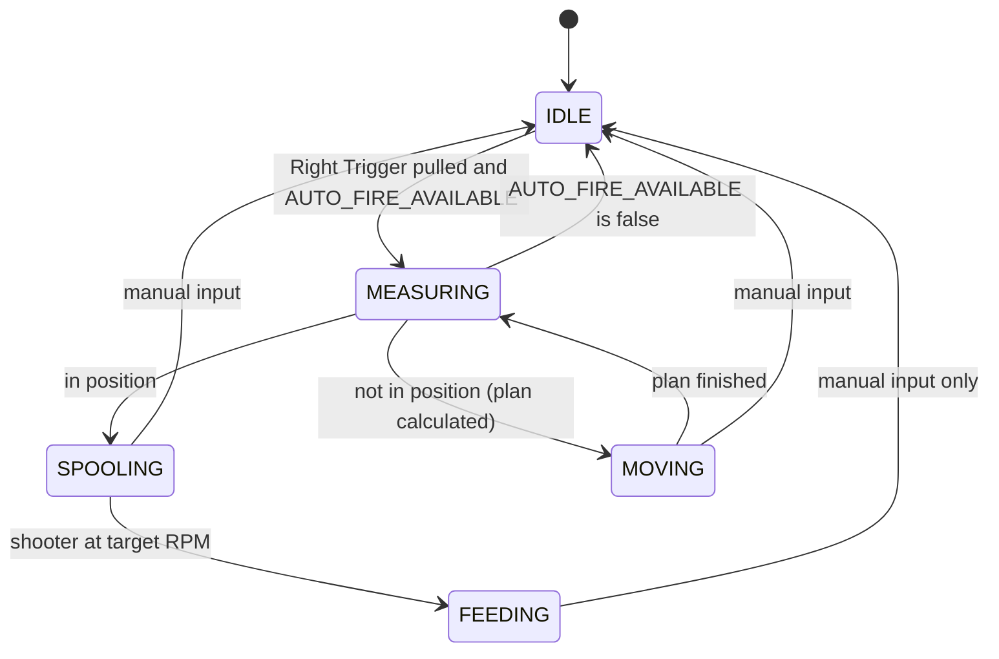

# FTC 2026 Biobuzz Challenge: TeleOp Technical Requirements
**Reference:** [FIRST Tech Challenge Game and Season](https://www.firstinspires.org/programs/ftc/game-and-season)

## Scope
This document covers the **TeleOp** period only: the 2-minute driver-controlled part of the match. The autonomous period (AUTO) is out of scope and will need its own document. Anything here about initialization, alliance selection, or the shooter applies to the TeleOp OpMode.

## How to Read This Document
Each section is split into two parts:

* **Requirement:** what the robot must do, as seen by the drivers. These change rarely, and every requirement should be testable on the field.
* **Design:** how we have decided to meet the requirement right now. These can change as we test, as long as the requirement is still met.

Facts we don't control, such as the field layout, the AprilTag IDs, and how our robot is built, are in the **Reference** section at the end. Every tunable value is listed in the **Tunable Values** table at the end.

---

## Hardware and Initialization

### Requirement
* During initialization, the robot must look for every device listed in Reference: Robot Hardware.
* If any single device cannot be found, it must not cause an error. The robot reports it as a warning on the Driver Hub and completes initialization.
* With a device missing, the robot keeps as much working as it can:
  * **No webcam:** auto fire and the auto-fire availability notification are disabled. Everything else works normally.
  * **No IMU:** auto fire is disabled, because its movement plans use the IMU to turn. Driving falls back to robot-centric (the sticks move the robot relative to the way it is facing).
  * **No drive encoders:** auto fire is disabled (it cannot measure the in/out move). The Driver Hub shows a warning. Driving still works.

### Design
* The webcam is named `camera` in the robot configuration.
* The IMU is named `imu` in the robot configuration. The Driver Hub adds this entry automatically (on I2C port 0), and it must not be deleted or renamed.
* The code must be told how the Control Hub is mounted (see Reference: Robot Hardware) so that the IMU measures the robot's heading correctly.

> **Note:** The intake and shooter vibrate the mounted webcam enough to drop AprilTag detections. That is a hardware/mounting issue; see Reference: Robot Hardware. Auto fire and the availability notification ride through short dropouts with the X-of-Y detection gate.

### Logging
Robot logs (`RobotLog`) are **verbose for the whole TeleOp** while we are bringing this up: every interface logs init, missing hardware, state changes, and the values it used for a decision. The same facts that drive the LED also go to the Driver Hub. We can later turn the volume down with a verbosity setting.

---

## Alliance Selection

### Requirement
The driver chooses the alliance (Red or Blue) during initialization, after pressing INIT and before pressing Play.

* On **Gamepad 1**, press **X for Blue** or **B for Red**.
* The choice can be changed any number of times before Play. The last press wins.
* The Driver Hub shows the current choice, or **NOT SET** if no alliance has been chosen.
* There is no default alliance. If Play is pressed without choosing one:
  * Auto fire is disabled (the Right Trigger does nothing), and the Driver Hub keeps showing a warning that the alliance is not set.
  * Everything else (driving, intake, hopper, shooter) works normally.
  * The driver can still choose an alliance with the same buttons. Once chosen, auto fire works and the alliance is locked for the rest of the match.
* Once Play is pressed with an alliance chosen, the alliance cannot be changed for the rest of the match.

### Design
The SDK supports this directly: `opModeInInit()` keeps a loop running until Play is pressed, and gamepad methods such as `xWasPressed()` detect a single button press.

---

## Shooter

### Requirement
* Shot strength must stay consistent for the whole match, including as the battery drains and as balls are launched.
* The operator can run the shooter forward, reverse it if it jams, and stop it.
* Auto fire starts the shooter only after the robot is aligned, waits until it is at the target RPM, then feeds. Manual hopper feed still needs the shooter already spinning.

### Design
A **gearbox** sits between the shooter motor and the wheel. That gives faster spin-up and spin-down, and more torque so the wheel does not sag as much when a ball goes through. Because spin-up is fast, the shooter does **not** run the whole match. Auto fire starts it after alignment (see Auto Fire).

Gamepad 2 still has a manual shooter:
* **A** (hold) runs forward at `SHOOTER_TARGET_RPM`. Release stops it.
* **Right Bumper** (hold) runs reverse (jam clear). Release stops it. Right Bumper wins if both are held.
* Manual hopper **X** does not start the shooter. Hold A if you are launching by hand.

`SHOOTER_RUN_ENTIRE_MATCH` still exists and starts **false**. If it is set true, the shooter also runs from Play until the match ends. That is no longer the intended match plan.

* The speed is a target speed in **RPM** at the **motor shaft**, `SHOOTER_TARGET_RPM` (starts at **2000**). Reverse uses the same RPM the other way.
* The gearbox means the wheel turns at a different RPM than the motor. Velocity control uses the motor encoder, so the code commands motor RPM. The wheel ratio is a hardware fact (see Reference: Robot Hardware).
* Auto fire treats the shooter as ready when measured motor RPM is at least `SHOOTER_READY_RPM_FRACTION` of the target (starts at **0.90**). If the motor type has no ticks/rev, auto fire cannot measure RPM and proceeds as soon as the power command is sent.
* The code does **not** auto-restart just because measured speed is near zero. A jam or a hand near the wheel should not fight the operator.

The shooter is controlled by target speed, not by motor power. With a fixed power, the shooter slows down as the battery drains over the match, and shots fall short. With a target speed, the motor controller on the hub adjusts the power on its own to hold the speed. This also brings the wheel back up to speed quickly after each shot.

This uses the FTC SDK's built-in velocity control on `DcMotorEx`:

```java
shooter.setMode(DcMotor.RunMode.RUN_USING_ENCODER);

double ticksPerRev = shooter.getMotorType().getTicksPerRev();
shooter.setVelocity(SHOOTER_TARGET_RPM / 60.0 * ticksPerRev); // ticks per second
```

* The shooter motor's **encoder cable must be connected** to the expansion hub. Without it, velocity control does not work.
* The shooter motor must be set to the correct motor type in the robot configuration on the Driver Station. `getTicksPerRev()` depends on it, so the wrong motor type gives the wrong speed.
* The RPM is measured at the motor's output shaft. The gearbox changes wheel speed relative to that. Set the motor type on the Driver Station to the **motor**, not the wheel.

> **Note:** Always-on (`SHOOTER_RUN_ENTIRE_MATCH`) is kept as a switch, default **false**. The gearbox is why we spool after alignment instead of running all match.

---

## Controller Map

Any input except Gamepad 2 Right Trigger cancels auto fire, then that same loop does the action below. Buttons and triggers that were **already held** when auto fire started do not cancel it (so a held intake plus a Right Trigger tap starts auto fire and keeps it). Sticks cancel immediately. A new press after start cancels.

### Gamepad 1 (driver)

| Input | Action |
|---|---|
| Left stick | Drive (field-centric: up = away from the driver) |
| Right stick left/right | Turn in place |
| Back (Share) | Zero heading / reset forward |
| X | Alliance = Blue (INIT, or after Play if still NOT SET) |
| B | Alliance = Red (INIT, or after Play if still NOT SET) |

### Gamepad 2 (operator)

| Input | Action |
|---|---|
| Right Trigger | Start auto fire (aim to the arc, then feed) |
| Left Trigger | Intake in (hold) |
| Left Bumper | Intake out (hold) |
| A | Shooter forward (hold). Not required for auto fire |
| Right Bumper | Shooter reverse (hold; jam clear) |
| X | Manual hopper feed +180° (hold to repeat). Can launch from anywhere. |
| Y | Hopper −180° (hold to repeat) |

---

## Driving (Gamepad 1)

### Requirement
Driving is **field-centric**: the sticks move the robot relative to the driver's view of the field, not relative to the way the robot is facing.

* **Left stick:** move the robot, from the driver's point of view.
  * Up: away from the driver.
  * Down: toward the driver.
  * Left and right: to the driver's left and right.
* **Right stick (left/right):** turn the robot in place.
* **Back button** (called Share on PlayStation-style gamepads): reset forward. The driver points the robot straight away from themselves and presses it, and that direction becomes the new forward. This corrects drift during the match, or a wrong starting direction.

**Drive team procedure:** before pressing INIT, place the robot **facing straight away from the driver** (for example, with its back against our own alliance's wall).

### Design
The red and blue drivers stand on opposite sides of the field, facing each other (see Reference: Field), so "away from the driver" points in opposite directions for the two alliances.

The IMU only measures how far the robot has turned since it was last zeroed, so forward is set like this:
* The IMU heading is zeroed during initialization, while the robot is facing away from the driver. From then on, forward means away from the driver, for either alliance.
* Because forward is set from the robot's starting direction, driving does not depend on the alliance selection.
* The Back button zeroes the IMU heading again.

> **Note:** If an autonomous program runs before TeleOp, the robot will not be facing away from the driver when TeleOp starts, and it cannot be touched during the transition. In that case the driver uses the Back button to reset forward once TeleOp begins. Passing the robot's heading from autonomous to TeleOp is out of scope for now.

---

## Operator Controls (Gamepad 2)

### Requirement
* **Right Trigger:** start auto fire (see Auto Fire). This is the only way to start the aim-and-feed sequence.
* **Left Trigger:** while held, run the intake inward at a predefined speed. Stops when released.
* **Left Bumper:** while held, run the intake outward at a predefined reverse speed. Stops when released.
* **A Button:** while held, run the shooter forward at the target RPM. Stops when released. Manual hopper feed needs this. Auto fire starts the shooter itself after alignment.
* **Right Bumper:** while held, run the shooter in reverse. Stops when released.
* **X Button:** manual hopper feed — step 180 degrees in the feeding direction. With the shooter spinning, this can launch a ball from anywhere.
* **Y Button:** step the hopper 180 degrees in the opposite direction (-180 degrees).

The triggers are either held or not. How far a trigger is pulled does not change anything. A small deadzone decides when a trigger counts as held.

For both hopper buttons:
* Pressing the button starts one 180-degree step.
* When the step finishes, the robot checks whether the button is still held. If it is, the hopper does another 180-degree step, and so on until the button is released.
* A step always finishes once started, even if the button is released partway through. This keeps the hopper lined up at a 180-degree position.

### Design
Both intake speeds are target speeds in **RPM**, each set by its own tunable value:
* `INTAKE_TARGET_RPM`: the inward speed, used by the Left Trigger (starts at **500**).
* `INTAKE_REVERSE_RPM`: the outward speed, used only by the Left Bumper (starts at **500**).

They use the same SDK velocity control as the shooter:

```java
intake.setMode(DcMotor.RunMode.RUN_USING_ENCODER);

double ticksPerRev = intake.getMotorType().getTicksPerRev();
intake.setVelocity(INTAKE_TARGET_RPM / 60.0 * ticksPerRev);    // Left Trigger: inward, ticks per second
intake.setVelocity(-INTAKE_REVERSE_RPM / 60.0 * ticksPerRev);  // Left Bumper: outward, ticks per second
intake.setVelocity(0);                                         // released: stop
```

* As with the shooter, the intake motor's **encoder cable must be connected** to the expansion hub, and the motor must be set to the correct motor type in the robot configuration.
* If the intake encoder (or a usable motor type) is missing, the intake runs at **100% power** instead of RPM. The Driver Hub shows a warning.

---

## Auto Fire Availability Notification

### Requirement
* The operator must be notified when **auto fire is available**: an alliance has been chosen, the IMU is working, the target-cell detection gate is passing, and the robot is **inside the shooting cone**. Pulling the Right Trigger at that moment starts auto fire.
* The notification must be obvious during a match without the operator having to look at the Driver Hub.
* The Driver Hub must show two separate booleans, so we can tell "we see the tags" apart from "we are in the cone":

| Telemetry line | What it shows |
|---|---|
| `TARGET_CELL_IN_VIEW` | `true` when the current camera sample found the **upright alliance cluster**. Otherwise `false`. |
| `AUTO_FIRE_AVAILABLE` | `true` when auto fire can start: alliance chosen, IMU working, detection gate passing, the robot is inside the shooting cone, and range is within `AUTO_FIRE_MAX_START_RANGE_IN`. Otherwise `false`. |

* The Driver Hub must also show the last known good geometry whenever the detection gate is passing.

### Design
* The LED strip flashes quickly while `AUTO_FIRE_AVAILABLE` is `true`. It does not flash merely because the tags are visible. The LED hardware is not in the robot configuration yet, so the LED interface is a no-op for the strip itself. Every LED state is still written to the Driver Hub and the robot log.
* The Driver Hub telemetry is updated every TeleOp loop with:

| Telemetry line | What it shows |
|---|---|
| `TARGET_CELL_IN_VIEW` | `true` when this sample found the upright alliance cluster. This is the raw camera result, for debugging. It can flicker when the intake or shooter shakes the webcam. |
| `AUTO_FIRE_AVAILABLE` | `true` when the robot is inside the shooting cone, close enough to start, and auto fire is allowed (alliance, IMU, and detection gate). This is what the LED follows. |
| Detection gate | How many of the last Y samples found the upright alliance cluster, for example `3/5`. |
| Target geometry | The last known good cluster pose of the **cell opening** (x, y, z, yaw, range, bearing, roll, percent of tags found). These are the same values auto fire uses. |

* When the detection gate is passing, the geometry lines show the last known good reading. That reading may be from the current sample, or from a recent sample that is still inside the gate.
* When the detection gate is not passing, the geometry lines show `--` instead of numbers, so a stale reading is never shown as current.
* `TARGET_CELL_IN_VIEW` can be `false` while `AUTO_FIRE_AVAILABLE` is still `true`: the current sample missed, but the gate is still passing and the last known good reading puts the robot in the cone. That is expected during a short vibration dropout.
* `TARGET_CELL_IN_VIEW` can be `true` while `AUTO_FIRE_AVAILABLE` is `false`: we see the target cell, but the robot is outside the cone, too far to start, or alliance / IMU is missing. Auto fire does not start. The driver must move into the cone and inside the start range.

**Detection gate (X of Y).** Intake and shooter vibration can make the mounted webcam miss tags for a sample or two even when the target cell is still in front of the robot (see Reference: Robot Hardware). To ride through those dropouts, every TeleOp loop records one camera sample:

* A sample is a **hit** if it found the upright alliance cluster, and a **miss** if it did not. A hit is what `TARGET_CELL_IN_VIEW` reports. Do not reject a hit only because `percentClusterFound` is low.
* The robot keeps the last **Y** samples, and the last geometry from a hit (the **last known good** reading).
* The gate **passes** when at least **X** of those Y samples were hits. X and Y are tunable (see Tunable Values).
* `AUTO_FIRE_AVAILABLE` uses the last known good reading to decide whether the robot is inside the cone and inside the start range, and stays `true` through a miss as long as the gate still passes, the robot is **not being driven**, and that reading is still valid.
* Last-known-good is for vibration dropouts **while the robot is stopped**. If the driver is moving the sticks, a miss clears last-known-good so the LED and availability cannot stay on from a stale in-cone pose.
* During `MOVING`, `SPOOLING`, and `FEEDING`, the tracker and gate are **frozen**. Vibration from the drive or the shooter cannot fail the gate mid-sequence. After a move, `MEASURING` uses a fresh sample.
* When the gate fails, `AUTO_FIRE_AVAILABLE` is `false` and the last known good reading is no longer used.

---

## Auto Fire

### Requirement
Auto fire is a one-press action. A single pull of the Right Trigger on Gamepad 2 starts the whole sequence: the robot drives itself to the shooting distance on the arc, aims at the target cell, and keeps shooting until a driver takes over. It doesn't matter whether the trigger is held down or released after the pull.

The shooter is held at a constant motor RPM (see Shooter) once it is up to speed, so shooting from the same distance every time gives a consistent shot. That is why auto fire moves the robot to a fixed distance from the target cell, not just turns it. The gearbox is why we can wait until we are aligned before spinning up.

The driver is responsible for getting the robot **into the shooting cone**. Auto fire does not drive in from outside the cone, and it does not path around the HIVE frame. Other robots also stay the driver's problem.

* **Starting:** auto fire starts only if `AUTO_FIRE_AVAILABLE` is `true` when the trigger is pulled (inside the cone, close enough to start, detection gate passing, alliance and IMU ready). It then uses the last known good geometry to plan the first move. If `AUTO_FIRE_AVAILABLE` is `false`, auto fire does not start and nothing else happens.
* **Moving:** the robot drives itself straight in or out to the **shooting arc** (defined below) and aims the shooter at the target cell. The shooter stays off during the move. After each move it checks its position again.
* **Spooling:** once the robot is at the right distance and aimed, auto fire starts the shooter and waits until measured RPM is at least `SHOOTER_READY_RPM_FRACTION` of `SHOOTER_TARGET_RPM`.
* **Shooting:** then it steps the hopper 180 degrees at a time, while keeping the shooter at the target RPM, until manual input is received.
* **Manual input ends auto fire.** Manual input is any button press, trigger pull, or joystick movement on **either Gamepad 1 or Gamepad 2**, except the Right Trigger on Gamepad 2. A small deadzone applies to joysticks and triggers so stick drift doesn't count as input. Manual input ends auto fire at any point in the sequence.
* **Losing the target or leaving the cone:** if `AUTO_FIRE_AVAILABLE` is `false` when the robot checks its position (at the start, or after a move — `MEASURING` only), auto fire ends. That covers the detection gate failing and the robot no longer being inside the cone. Once `SPOOLING` or `FEEDING` has started, availability is ignored.
* **When auto fire ends**, the hopper stops and the shooter stops, then the same loop applies manual shooter control (so A still held would start it again). Normal driver control resumes on that loop. If the input that ended auto fire is a drive direction (a stick past the deadzone), the drive motors immediately move that way. They are not stopped first. If there is no drive input (the target was lost, or the cancel was a button or trigger), the drive motors stop.
* **Pulling the trigger again** while auto fire is running does nothing. It neither restarts nor cancels the sequence.
* Auto fire does not try to detect when the HIVE tips. Once shooting starts, it keeps shooting until manual input.
* **Obstacles:** auto fire's only move is in or out along a line to the cell, while already inside the cone. It does not avoid the HIVE frame, the downward-facing CELLS, or other robots. The drivers watch the path and cancel with any manual input if the robot is about to hit something.

**Shooting cone:** a **90-degree sector** on the field, point at the **cell opening**. It has **no maximum distance**. It is not a triangle.

* Standing under the cell and looking the way its tags face (flattened onto the field), a position is in the cone if it is no more than 45 degrees to the left or right.
* The cone is only an angle test. Being in the cone does not by itself mean auto fire may start.
* The cone is measured from the cell's point of view, not the robot's. It doesn't matter which way the robot is facing or where the cell appears in the camera image.

**Start range:** auto fire may start only if the robot is in the cone **and** the horizontal distance to the opening is at most `AUTO_FIRE_MAX_START_RANGE_IN` (starts at **60 in**). Farther than that, `TARGET_CELL_IN_VIEW` can still be true, but `AUTO_FIRE_AVAILABLE` is false. That keeps auto fire from beginning a long encoder drive across the field. The driver moves closer, then pulls the trigger.

**Shooting arc:** the set of positions auto fire shoots from. It is the curved line inside the shooting cone that is exactly the **shooting distance** from the cell opening. Every point on the arc gives the same shot. This is the only range at which we shoot. It is not the far edge of the cone.

Because auto fire only starts inside the cone and inside the start range, the first move is a short drive straight in or out to the arc.


*Top-down view. The blue sector is the cone (no far edge). The dashed red arc is the max start range. Robot A is in the cone and inside the start range, too far from the shooting arc: moves straight in. Robot B is too close and moves straight out. A robot in the cone but beyond the dashed arc would see the tags and not be allowed to start. To redraw this image, run `python docs/autofire_cone.py` (requires matplotlib).*

### Design
Auto fire works in rounds of **measure, then move**. The camera is used only while the robot is stopped. Each move follows a movement plan calculated from the last measurement, using the IMU and the drive wheel encoders. During `MOVING` the detection gate and last-known-good are frozen (the webcam may still stream for logs). Road Runner and path following are not used.

Auto fire runs these steps:

1. **Check the target.** Used in `MEASURING` only (the start of a measure-then-move round, including after a move). If `AUTO_FIRE_AVAILABLE` is `false` (detection gate not passing, outside the cone, or beyond the start range), auto fire ends. Otherwise use the last known good geometry. That geometry is refreshed whenever a sample finds the cluster, and is reused on a miss as long as the gate still passes. `SPOOLING` and `FEEDING` do not run this check.
2. **Measure.** Read the last known good geometry of the target cell: the robot's position (x, y, z) and yaw relative to the **cell opening** (see Cell opening below). The position is used for the shooting arc. Roll has already decided that this cluster is the upward-facing cell (see Target Cell).
3. **Check the position.** If the robot is in position, stop the drive motors and go to step 6. Otherwise, go to step 4. The robot is in position when all of these are true:
   * the distance to the cell opening is within `DISTANCE_TOLERANCE_IN` of `SHOOTING_DISTANCE_IN`;
   * the aim (where the shooter points compared with the direction to the opening, including `AIM_OFFSET_DEG`) is within `ALIGNMENT_TOLERANCE_DEG`, to either side;
   * the robot is inside the shooting cone.
4. **Plan and move.** Calculate a movement plan from the robot's current position to the point on the shooting arc directly toward or away from the opening, ending with the shooter aimed at the opening. The shooter stays off. Carry out the plan:
   * **Turning** is controlled by the IMU heading.
   * **Driving and strafing distances** are controlled by the drive wheel encoders.
   * `AIM_OFFSET_DEG` is added to the final aim angle to correct for shots that consistently miss to one side during testing. It starts at 0.
5. **Repeat.** When the move is finished, go back to step 1.
6. **Spool.** Start the shooter at `SHOOTER_TARGET_RPM`. Stay here until measured motor RPM is at least `SHOOTER_READY_RPM_FRACTION` of the target. Then go to step 7.
7. **Feed.** Keep the shooter at the target RPM and step the hopper 180 degrees at a time until manual input is received.

Mecanum wheels slip, especially when strafing, so a move won't land exactly where it was planned. Steps 1 to 3 catch that: after each move the robot measures again and makes a smaller correction if needed. Two or three rounds should be enough.

The SDK samples `RobotAutoDriveByGyro_Linear` (turning to a heading with the IMU) and `RobotAutoDriveByEncoder_Linear` (driving a set distance with the wheel encoders) show the building blocks for step 4.

Auto fire owns the shooter while it is active: off during `MEASURING` and `MOVING`, on during `SPOOLING` and `FEEDING`. Manual Gamepad 2 A is ignored until auto fire ends.

**State machine.** Auto fire is built as a state machine that advances one step per TeleOp loop, so driving, telemetry, and cancelling keep working while it runs:



| State | What the robot is doing | Leaves when |
|---|---|---|
| `IDLE` | Nothing; normal driver control | The Right Trigger is pulled and `AUTO_FIRE_AVAILABLE` is `true`: go to `MEASURING` |
| `MEASURING` | Stopped; shooter off; reads the last known good target-cell geometry (steps 1 to 3) | `AUTO_FIRE_AVAILABLE` is `false`: `IDLE`. In position: `SPOOLING`. Otherwise: calculate a plan and go to `MOVING` |
| `MOVING` | Carrying out the movement plan (step 4), shooter off, without checking the camera | Plan finished: `MEASURING`. Manual input: `IDLE` |
| `SPOOLING` | Stopped; shooter spinning up to `SHOOTER_TARGET_RPM` | At ready RPM: `FEEDING`. Manual input: `IDLE`. Availability is ignored. |
| `FEEDING` | Stopped; shooter at target RPM; stepping the hopper 180 degrees at a time | Manual input: `IDLE`. A HIVE tip or `AUTO_FIRE_AVAILABLE` going false does **not** end this state. |

Manual input sends any state back to `IDLE`. Every return to `IDLE` stops the hopper and the shooter, then that same loop applies manual shooter control. Drive is handed back to Gamepad 1 on that same loop: if a stick is already held, the robot starts moving in that direction immediately. The drive motors are only stopped when there is no drive input.

**Cell opening.** On BIOBUZZ, the SDK's cluster `ftcPose` is already the **cell opening**, not the sticker. FIRST places the cluster origin at a virtual point in the mouth of the goal ([AprilTag Clusters](https://ftc-docs.firstinspires.org/en/latest/tech_tips/tech-tips/tech-tip-apriltag-clusters/tech-tip-apriltag-clusters.html)). Seeing any one of the four member tags is enough: the SDK returns one `AprilTagClusterDetection` whose pose is that opening. More visible tags only make the same pose steadier. There is no sticker-to-opening offset.

* All of auto fire's distances, aim angles, and cone checks use this cluster pose as-is.
* `AIM_OFFSET_DEG` is still used if shots consistently miss left or right (shooter vs camera). It is not a sticker-to-opening correction.

**Shooting distance.** `SHOOTING_DISTANCE_IN` and `AUTO_FIRE_MAX_START_RANGE_IN` are `hypot(ftcPose.x, ftcPose.y)` in the **camera frame**, not a tape measure on the tiles. The camera is tilted, so that is not exactly the field-plane distance. Tuning on the field absorbs the constant camera-behind-shooter gap (~6 in) and a typical tilt bias; it does not project every pose onto the floor. We do not apply a camera-tilt correction in software.

**Future improvements.** Not in this TeleOp. Written down so we do not lose the ideas:

1. **Start from outside the cone.** If the tags are visible but the robot is outside the cone, auto fire would drive to the nearer 45-degree end of the shooting arc, then aim and shoot. The driver would no longer have to get into the cone first.
2. **Path around the HIVE frame.** The frame is a fixed structure. Once we have the target cell's pose, we know where the frame is and could plan a path that goes around it instead of through it. Other robots still cannot be avoided this way; the driver would still cancel if another robot is in the way.

---

## Target Cell

### Requirement
* **The target cell is the upward-facing CELL of our alliance's color** (see Reference: Field for what a CELL is).
* Only one of our two CELLS can be up at a time, so there is always exactly one target cell.

### Design
BIOBUZZ has **four AprilTag clusters and no standalone tags**. The official library will not return `AprilTagSingleDetection` for IDs 30–45. Member-tag IDs are field facts only (see Reference: Field). The code uses cluster detections.

* A sample is a hit if it sees an `AprilTagClusterDetection` whose name is our alliance (`RED SCORING` / `RED AUDIENCE` or `BLUE SCORING` / `BLUE AUDIENCE`) **and** `|ftcPose.roll| < 90`.
* Seeing any one member tag yields that cluster's pose at the **cell opening**. Seeing more of the four tags does not change which point is reported; it only steadies it.
* `percentClusterFound` is logged and shown on the Driver Hub. A low percentage can mean occlusion. It is not a reject rule by itself.

**Telling which CELL is up.** The official test is cluster orientation, not tag height ([AprilTag Clusters](https://ftc-docs.firstinspires.org/en/latest/tech_tips/tech-tips/tech-tip-apriltag-clusters/tech-tip-apriltag-clusters.html)):

* If `|ftcPose.roll| < 90` (roll between −90 and 90), the cluster is right-side up from the camera and the CELL is scorable.
* If `|ftcPose.roll| ≥ 90`, the cluster is upside down and that CELL is not the target.
* FIRST's example: `RED AUDIENCE` at roll −19.7 is up; `RED SCORING` at roll 159.3 is the down cell on the far side.
* This assumes the camera looks the same way the shooter launches, which ours does.

---

## Vision

### Requirement
When the robot is stopped and the target cell's tags are in view, the webcam must deliver fresh geometry quickly enough that auto fire can measure, then move, without waiting on a slow camera pipeline. The Driver Hub's display of that geometry may lag behind what the robot itself has already read.

### Design
On 11 Oct 2026 we timed the path from the Logitech C920 webcam to geometry in `IronEaglesTeleOp2026`, with the robot running on the field and the official red scoring tag cluster in view.

* The camera streams at about **30 frames per second** (a new image every ~33 ms) while it is open.
* The TeleOp loop reads the latest detections faster than that, so it does not drop frames.
* When a tag appears or disappears, the robot has the new result in about **one or two frames**, typically ~60 ms. The fastest changes we logged were 13–14 ms apart.
* The Driver Hub updates more slowly than the robot. Watching the Hub understates how often the code actually has a new reading.
* The SDK reports a **cluster** (`RED SCORING`) whose pose is the cell opening, not four separate tags and not the sticker. In this test it usually saw 25–50% of the cluster at a time. That percentage is a health hint, not a filter.

The refresh rate is not the remaining vision risk. The remaining risk is the camera's narrow view of the tags. Losing the lock when the image is shaken is a confirmed hardware issue (see Reference: Robot Hardware). Auto fire and the availability notification ride through short dropouts with the X-of-Y detection gate (see Auto Fire Availability Notification).

---

## Reference

### Field
From the BIOBUZZ Competition Manual (Sections 9.5, 9.6, and 9.9). This document uses the manual's terms:

* **HIVE:** one of the two seesaw structures on the frame in the center of the field. There is one red HIVE and one blue HIVE, sitting side by side, parallel to each other.
* **CELL:** one end of a HIVE, which balls are launched into. Each HIVE has two CELLS, one at the audience end and one at the far end, so there are four CELLS on the field.

Each HIVE pivots like a seesaw and is always in one of two positions, with exactly one of its CELLS facing up. Launching enough balls into the upward-facing CELL tips the HIVE, so the other CELL becomes the upward-facing one.

**Drivers:** the drivers stand in their ALLIANCE AREA, on the side of the field: red on the left as seen from the audience, blue on the right. The red and blue drivers face each other across the field.

**AprilTags:**
* Each CELL has one **AprilTag cluster**: four AprilTags in a row on a single sticker. Official names: `RED SCORING`, `RED AUDIENCE`, `BLUE SCORING`, `BLUE AUDIENCE`.
* The cluster is on the bottom face of the CELL, facing down toward the tiles, with its bottom edge toward the center of the field. The camera has to see the tags from below.
* The SDK cluster pose is a virtual point at the **cell opening**, not the sticker. Member-tag IDs are listed here as field facts. The TeleOp code does not read those IDs; BIOBUZZ has no standalone tags.
* The tags are from the **36h11** family and are **3.25 in (8.25 cm)** square. The default season library already has the sizes.

| CELL | Cluster name | AprilTag IDs (field facts only) |
|---|---|---|
| Red, far side (scoring table / opposite the audience) | `RED SCORING` | **30, 31, 32, 33** |
| Red, audience side | `RED AUDIENCE` | **34, 35, 36, 37** |
| Blue, audience side | `BLUE AUDIENCE` | **38, 39, 40, 41** |
| Blue, far side (scoring table / opposite the audience) | `BLUE SCORING` | **42, 43, 44, 45** |

### Robot Hardware
* **4 wheel motors** (REV DC motor)
* **1 intake motor** (REV DC motor, spins rapidly to intake balls into the robot)
* **1 shooter motor** (REV DC motor) with a **gearbox** to the shooter wheel. The gearbox is for faster spin-up/spin-down and to hold speed as balls fire. **To be filled in:** gearbox ratio. `SHOOTER_TARGET_RPM` is motor-shaft RPM.
* **1 hopper motor** (REV Core Hex motor, feeds balls into the shooter)
* **An LED strip**
* **A webcam** (sees the AprilTags on the CELLS)
* **The IMU** built into the Control Hub (measures which way the robot is facing)

An expansion hub connects the intake motor, shooter motor, and hopper motor.

Due to the way the wheels are mounted, the **FRONT RIGHT** and **BACK LEFT** wheel motors must turn in the inverse direction as the other two. Confirmed 15 Oct 2026: with forward held, back left spun backward until it was reversed in code.

**Drive wheel encoders:**
* Auto fire measures drive/strafe distance with the four wheel encoders. Init requires the four drive motors to be **present in the hardware map**. If any is missing, auto fire is disabled.
* Unplugged encoder cables cannot be proven at rest. We assume they are connected.
* Encoder inches = ticks / (π × `WHEEL_DIAMETER_IN`). Ticks per revolution come from the motor type in the robot configuration. If the type has no ticks/rev (`UnspecifiedMotor`), we log a warning and use **537.7** (common goBILDA 312 RPM) so auto fire can still run.
* `IronEaglesConfig.xml` currently has `UnspecifiedMotor` on the drive, intake, and shooter. The hopper is a **REV Core Hex**. Set the real drive/intake/shooter types on the Driver Station; wrong types make RPM and encoder inches wrong.

**Webcam:**
* Plugs into a USB port on the Control Hub.
* Mounted on top of the robot, at the center of the robot, in line with the shooter (no left/right offset).
* The shooter is about 6 inches in front of the camera. Distances from the camera are therefore longer than the distance from the shooter. Auto fire uses camera-frame `hypot(x, y)` and is tuned by testing. There is no separate tilt-projection correction.
* The AprilTags face down from the underside of the CELLS, so the camera must be tilted up enough to see them from where the robot shoots.
* Mounted about **11 in** above the tiles, tilted up about **15 deg** (nearly level with the robot). These are hardware notes, not algorithm inputs. The up-cell test uses cluster roll, not camera height.
* **Vibration:** the intake and shooter shake the robot. With the webcam mounted, that shake stops AprilTag detections. We confirmed this on 12 Oct 2026 by unmounting the webcam and running the intake and shooter at full speed: the camera then kept a lock for 10 seconds with no misses. This is a mounting issue, not a camera or lighting issue. A stiffer or isolated mount is the hardware fix. Until then, auto fire and the availability notification use the X-of-Y detection gate so brief dropouts do not immediately disable them (see Auto Fire Availability Notification).

**IMU:**
* Built into the Control Hub, so there is no wiring.
* The Control Hub is mounted on the **right side** of the robot with the logo **upright** (not upside down). The code uses logo facing **up**. USB direction is assumed **forward** until we measure it on the robot (`IMU_LOGO_DIRECTION`, `IMU_USB_DIRECTION`).

---

## Design Decisions (13 Oct 2026)

Answers that change the TeleOp implementation. Tunable starting values are in the table below.

1. **Replace `IronEaglesTeleOp2026` in place.** Yes. The Road Runner / right-bumper aim-assist TeleOp is deleted. The Driver Hub entry stays `IronEaglesTeleOp2026`.
2. **Missing measurements.** Use named tunables for RPM, shooting distance, wheel diameter, and IMU orientation. Shooter RPM starts at **2000**; intake inward and reverse start at **500**. Shooting distance starts at 2 ft from the cell opening. Control Hub is on the right side, logo upright; USB is assumed forward. Wheel diameter starts at 3 in. Drive encoders are assumed plugged in; init checks that the four drive motors (and a usable motor type) are present and disables auto fire if they are not. Robot logging is verbose across the whole TeleOp. Camera height (~11 in) and tilt (~15 deg) are mounting notes only.
3. **LED.** Hardware is unknown / not in the config. Keep `LedInterface` with a no-op implementation. Every LED state is also written to the Driver Hub and the robot log.
4. **Intake without an encoder.** Fall back to 100% power and show a Hub warning. Do not leave the intake stopped.
5. **Drive encoders missing.** Disable auto fire and notify the driver. Driving still works.
6. **Cluster pose and upright test (14 Oct 2026).** A hit is an alliance cluster (`RED` / `BLUE` in the name) **and** `|ftcPose.roll| < 90`. The cluster pose is the cell opening. There is no single-tag ID fallback (BIOBUZZ has four clusters and no standalone tags) and no height filter. Do not apply a sticker-to-opening offset.
7. **Hopper Y.** `stepReverse180()` is a true −180° step, same hold-to-repeat as X.
8. **Manual cancel vs operator actions.** Any controller input except Gamepad 2 Right Trigger cancels auto fire, then that same loop performs the inputted action (sticks drive immediately; a held intake trigger starts the intake immediately).
9. **Shooting cone is a sector, not a triangle (14 Oct 2026).** The cone is an infinite 90° sector (angle only). Auto fire also requires range ≤ `AUTO_FIRE_MAX_START_RANGE_IN` so a start cannot begin a long encoder drive. The shooting arc is the only range at which we shoot.
10. **Manual shooter and hopper feed (14 Oct 2026).** Right Trigger is the only way to start auto fire, not the only way to launch. Gamepad 2 X is a manual hopper feed. A runs the shooter forward; Right Bumper holds reverse. The loop re-sends the shooter command. A near-zero velocity warning is shown; we do not auto-restart.
11. **SPOOLING and FEEDING end only on manual input (15 Oct 2026).** `AUTO_FIRE_AVAILABLE` is checked at start and in `MEASURING` only. Once `SPOOLING` starts, a HIVE tip or a lost cluster does not stop the sequence. The driver cancels.
12. **Held intake plus Right Trigger (14 Oct 2026).** Buttons and triggers already held when auto fire starts do not cancel it. Sticks still cancel immediately. A new button press after start cancels.
13. **Gate frozen during MOVING, SPOOLING, and FEEDING (15 Oct 2026).** Last-known-good is only reused on a miss while the robot is stopped in `MEASURING`. Driving clears a miss so the LED cannot stay on from a stale in-cone pose. Shooter vibration during spool and feed cannot fail the gate either.
14. **Speeds are RPM numbers (15 Oct 2026).** Coach-set starting targets: shooter **2000 RPM**, intake **500 RPM** (inward and reverse). Converted to ticks/s with `RPM / 60 × ticksPerRev`. If the motor type has no ticks/rev, the intake falls back to 100% power and the shooter falls back to a power estimated from the motor type's max ticks/s.
15. **Back left drive motor reversed (15 Oct 2026).** Holding forward spun the back left wheel backward. `backLeft` is now `Direction.REVERSE` in hardware, same as `frontRight`. Retract this if a later test shows a different wheel was mis-wired.
16. **Shooter is manual unless auto fire is spooling or feeding (15 Oct 2026).** `SHOOTER_RUN_ENTIRE_MATCH` starts **false**. Hold Gamepad 2 A for forward, Right Bumper for reverse. Always-on is no longer the intended match plan.
17. **Shooter gearbox and spool-then-feed (15 Oct 2026).** A gearbox is on the shooter for faster spin-up/down and to hold speed as balls fire. Auto fire keeps the shooter off until the robot is in position, then `SPOOLING` until RPM ≥ `SHOOTER_READY_RPM_FRACTION` of target, then `FEEDING` (shooter + hopper) until manual input.

---

## Tunable Values
All of these are configured after testing. They live in `TunableValues.java`.

| Value | What it controls | Starting value |
|---|---|---|
| `SHOOTER_RUN_ENTIRE_MATCH` | If true, the shooter also runs from Play until the match ends. Auto fire still spools after alignment | **false** |
| `SHOOTER_TARGET_RPM` | Shooter motor-shaft speed when running | **2000 RPM** |
| `SHOOTER_READY_RPM_FRACTION` | Fraction of target RPM that counts as “up to speed” before auto fire feeds | **0.90** |
| `INTAKE_TARGET_RPM` | Intake inward speed (Left Trigger) | **500 RPM**; **100% power** if the intake encoder is missing |
| `INTAKE_REVERSE_RPM` | Intake outward speed (Left Bumper) | **500 RPM**; **100% power** if the intake encoder is missing |
| `IMU_LOGO_DIRECTION` | Control Hub logo facing, for IMU heading | **UP** (hub on the right side, logo upright) |
| `IMU_USB_DIRECTION` | Control Hub USB facing, for IMU heading | **FORWARD** (assumed until measured) |
| `SHOOTING_DISTANCE_IN` | Camera-frame `hypot(x, y)` to the opening at which we shoot. Not a tile tape measure. | **24 in** (2 ft) |
| `AUTO_FIRE_MAX_START_RANGE_IN` | Farthest horizontal range at which auto fire may **start**. The cone itself has no max distance. | **60 in** |
| `DISTANCE_TOLERANCE_IN` | How close to the shooting distance the robot must be before auto fire shoots | **2 in** |
| `AIM_OFFSET_DEG` | Correction added to the auto-fire aim angle if shots miss consistently left or right | 0 |
| `ALIGNMENT_TOLERANCE_DEG` | How close the aim must be before auto fire shoots | **5 deg** |
| `AUTO_FIRE_DRIVE_POWER` | Drive/strafe power while carrying out a movement plan | **0.4** |
| `AUTO_FIRE_TURN_POWER` | Turn power while carrying out a movement plan | **0.3** |
| `WHEEL_DIAMETER_IN` | Drive wheel diameter, for encoder inches | **3 in** |
| `TAG_DETECTION_MIN_HITS` (X) | Hits needed in the last Y camera samples for the detection gate to pass | 3, then tuned on the field with the intake and shooter running |
| `TAG_DETECTION_WINDOW` (Y) | How many recent camera samples the detection gate looks at | 5, then tuned on the field with the intake and shooter running |
| `DEADZONE` | How far a stick or trigger must move to count as input | **0.05** |
